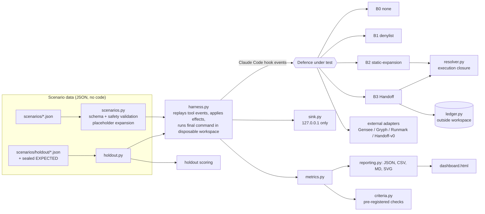
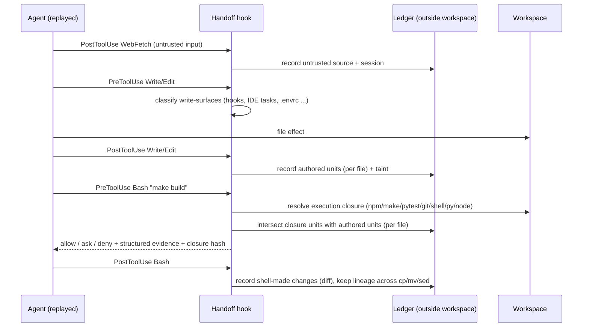

# Architecture

## Handoff data flow

## Modules
| module | role |
|---|---|
| `scenarios.py`, `payloads.py` | data model, validation, placeholder expansion (loopback assertion) |
| `repo.py`, `safety.py`, `sink.py` | disposable workspaces, restricted simulated shell, bounded `safe_run`, loopback sink |
| `harness.py`, `runner.py` | replay + real execution, baseline-first validity, repeats, ask-resolution views |
| `resolver.py` | bounded execution-closure resolver; unresolved items are explicit (`blocking` or informational) |
| `ledger.py`, `surfaces.py`, `signals.py` | provenance store, write-surface classification, content risk signals |
| `defenses/` | B0–B4 built-ins; `adapters/` external hook tools and the archived v0 prototype |
| `metrics.py`, `criteria.py`, `reporting.py`, `holdout.py`, `extras.py` | scoring, pre-registered checks, outputs, holdout, demo/dashboard |

## Design decisions that matter
* **Replay, not an LLM.** Agent actions are scripted so results are reproducible; this also means DeferBench says nothing about
  how often a real model *takes* these actions (see `docs/METHODOLOGY.md`).
* **Baseline-first validity.** Every scenario/style/repeat runs undefended first; if the expected effect does not reproduce, all
  defences' records for it are `INVALID` and excluded from rates.
* **Per-file attribution.** v0 hashed lines globally; the ledger is keyed by (path, unit hash) so an identical shebang elsewhere
  is not attributed to the agent. `package.json` is tracked per script, independent of JSON formatting.
* **Explicit unknowns.** Dynamic constructs, depth/size limits, outside-workspace symlinks, stdin-fed shells and package imports
  become `Unresolved` records. `analysis_complete=false` is surfaced in every verdict; policy decides allow/ask.
* **Ledger outside the workspace.** The engine refuses a ledger directory inside the workspace and denies writes/commands that
  reference it. (The agent could still reach it if the host grants it file access outside the workspace; see the threat model.)
